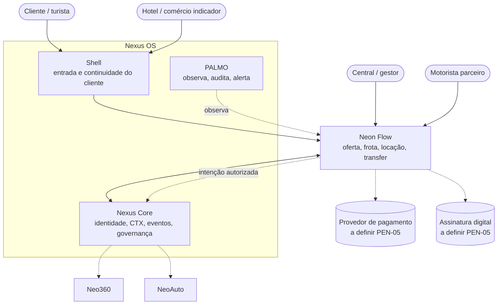
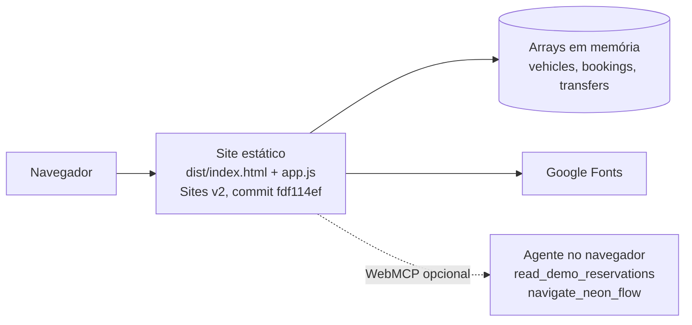

# Arquitetura

A arquitetura de hoje é um site estático sem backend. A arquitetura-alvo **não está decidida**: depende de localizar os donos existentes no Nexus OS (PEN-35) e auditar o Replit (PEN-36). Os diagramas "alvo" abaixo mostram responsabilidades propostas, não tecnologia.

## Contexto (C4 nível 1) — alvo proposto

## Containers (C4 nível 2) — estado atual

Sem backend, banco, autenticação, API, fila ou integração. Ver [SPEC-0001](../specs/SPEC-0001-prototipo-as-built.md).

## Requisitos de qualidade do alvo

Tirados dos critérios propostos no Dossiê K. Nenhum foi implementado.

| Atributo | Critério |
| --- | --- |
| Consistência | Concorrência não permite overbooking (PEN-24) |
| Idempotência | Repetir uma operação não duplica efeitos financeiros nem oportunidades |
| Isolamento | Outro tenant não acessa reservas ou documentos (PEN-49) |
| Rastreabilidade | Pagamento reconciliado e estorno preservam o histórico |
| Durabilidade | Dados sobrevivem a recarga e falhas (PEN-21) |
| Autoridade | Mudança material exige novo aceite. A IA não executa fora da sua autoridade |
| Acessibilidade | Mobile e teclado verificados (PEN-51) |

## Documentos

- [integracoes.md](integracoes.md): contratos propostos com Shell, Nexus e outras verticais.
- [adr/README.md](adr/README.md): decisões registradas.
