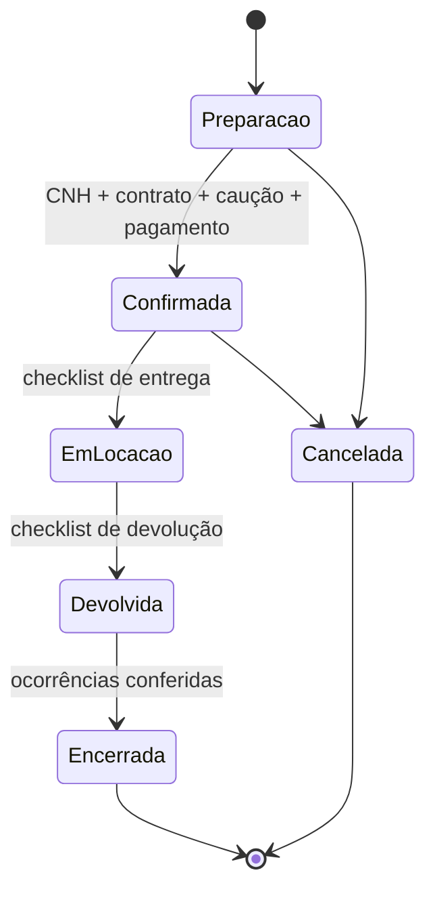

# RN-0004 — Etapas do ciclo de locação

**Regra:** a locação passa por cinco etapas, em ordem, e cada avanço exige a conferência da etapa atual.

**Status:** `prototipo`. A sequência é uma síntese operacional da Base v1.1 §5, e a ordem exata precisa ser definida com a operação.

## Detalhes e exceções

- A proteção contra pular etapas está só na interface. `advance` chamado direto passa da etapa 4 para 5 (PEN-26).
- O checklist real (fotos, combustível, km, avarias) não foi especificado (PEN-18).

## Onde está hoje

- Código: `bookingModal` e `advance` (`dist/app.js:44-45`).
- Testes: [TC-0001](../../qualidade/TC-0001-ciclo-de-locacao-prototipo.md), cenários CT-05 e CT-12.
