# Jornada do cliente

A jornada pretendida tem 13 etapas. O protótipo cobre parcialmente da reserva ao encerramento, sempre com dados simulados.

```mermaid
flowchart LR
  A[Entrada<br/>Shell, QR, hotel, Instagram] --> B[Identificação]
  B --> C[Intenção<br/>aluguel, transfer, passeio]
  C --> D[Qualificação<br/>condutor, datas, capacidade]
  D --> E[Proposta]
  E --> F[Negociação]
  F --> G[Conversão<br/>contrato + pagamento + bloqueio]
  G --> H[Execução<br/>entrega, uso, devolução]
  H --> I[Pós-venda<br/>ocorrências, caução, repasse]
  I --> J[Recorrência]
  C -. mudança de intenção .-> D
```

| Etapa | Comportamento pretendido | No protótipo |
| --- | --- | --- |
| Entrada | Shell, link, hotel, QR, Instagram ou contato | Não captura leads |
| Identificação | Pessoa, papel, assunto e origem sem duplicar | Nome livre, sem CID/tenant |
| Intenção | Alugar, transfer, passeio, datas e destino | Só formulário de reserva |
| Qualificação | Condutor, bagagem, horários, capacidade | Não existe |
| Proposta | Oferta, tarifa, período e validade | Cálculo por diária, sem versão |
| Negociação | Exceções aprovadas e nova confirmação | Não existe (PEN-19) |
| Conversão | Contrato e pagamento comprovados, disponibilidade bloqueada | Flags simuladas |
| Execução | Entrega, uso e devolução, ou transfer concluído | Transições locais |
| Pós-venda | Ocorrências, cobrança adicional, caução, repasse, satisfação | Checkbox final |
| Recorrência | Retomar preferências válidas | Não existe |
| Pausa / mudança | Suspender e requalificar | Não existe |
| Encerramento | Resolver pendências e preservar histórico | Etapa 4. Recarregar apaga tudo |

## Distinções obrigatórias

Uma visita não é lead. Interesse não autoriza contato. Reserva em preparação não é contrato. Marcar "recebido" não comprova pagamento. Transfer concluído no botão não comprova o serviço.
